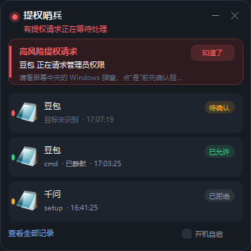

# 提权哨兵 · UAC Sentinel

常驻右下角托盘的提权监控小窗：**任何程序弹出 Windows 提权（UAC）窗口时，它按风险决定吵不吵你**，并把"谁在提权、目标是什么、结果如何"记下来。

专为同时挂着豆包、千问、DeepSeek、WorkBuddy 这类 AI 智能体、又常常错过权限弹窗的场景做的。对所有程序生效。



## 现在的行为（v0.2）

### 三级提醒

| 级别 | 什么情况 | 表现 |
|---|---|---|
| 低 | 知名厂商签名、系统目录、常规安装 | 无声，只记一条，标"已静默" |
| 中 | 签名未知/未签名，但用途正常 | 响一声，卡片停 8 秒 |
| 高 | 未签名或路径可疑，涉及删除、写注册表、装服务、改启动项、下载执行、编码命令、关防护 | 红色横幅 + 连续提示音 + 置顶，点"知道了"才消失 |

### 规则打分 + 本地小模型

1. 规则先算 0–100 分（签名、发布者、路径、操作类型、命令行关键词），直接决定等级。
2. 本地模型 **Qwen3.5 0.8B**（Q4，约 1.3 GB）只在事后给一句中文解释，并且**只能把等级升到"高"**，不能降级、不能替你把等级调低。
3. 模型 2.6 秒超时，Ollama 没开/模型没装 → 自动退回纯规则，不报错、不卡界面。
4. 模型用完 30 秒自动卸载（`keep_alive=30`），实测常驻内存约 560 MB，闲置后 `ollama ps` 为空。

> 模型不参与"要不要静默"的最终决定；静默只由规则和你的历史选择决定。

### 信任规则（比"同一程序 3 次"严格得多）

静默键 = **来源程序 + 来源发布者 + 目标程序 + 目标发布者 + 操作指纹**（操作指纹是命令行归一化后的动作 + 参数骨架）。

- 同一个键由你手动允许满 3 次、且 7 天内没有拒绝过，才降为"低"。
- **删除、写注册表、装服务、改启动项、下载执行、关防护**——这些无论重复多少次都不静默。
- 任何一次拒绝都会把该键清零。
- 静默也留记录，详情页可查风险分和模型理由。

### 托盘与跟随

- 默认收在右下角托盘折叠框，没有任务栏按钮；`×` 只是收起，托盘右键才真正退出。
- 检测到 DeepSeek Harness / 豆包 / 千问 / WorkBuddy / 小硕 等在跑 → 面板自动出现；全部退出 3 分钟后自动收起。
- 托盘右键：显示面板 / 预览提醒 / 提醒声音 / 开机自启 / 打开数据文件夹 / 退出。


### 项目状态（v0.3 新增）

底部"项目 N"或托盘右键"项目状态"，打开一个列表，直接读 DSH 的会话缓存，显示：

| 列 | 说明 |
|---|---|
| 状态 | 运行中（绿色）/ 已完成 / 已中断（红色） |
| 项目 / 会话 | 会话标题 |
| 轮次 | 已经进行到第几轮 |
| 最后活动 | 刚刚 / N 分钟前 / 昨天 |
| 工作目录 | 会话所在的工程目录 |

判断规则：最后一轮的回复还是空的、且 10 分钟内还有写入 → **运行中**；最后一轮有回复 → **已完成**；回复为空但超过 10 分钟没动静 → **已中断**。列表每 5 秒自动刷新。

主面板标题栏也会顺带显示"X 个项目在跑"，不打开列表也能一眼看到。


### 接入其他 AI 助手

看板除了读 DSH 自己的会话，还会读 `%LOCALAPPDATA%\AgentStatus\*.json`。
任何 AI 助手（豆包、千问、WorkBuddy 等）只要按约定写这个文件，就会出现在“项目状态”列表里；
写不了文件也可以提供 `GET http://127.0.0.1:<port>/agent-status` 的本地接口。
给它们的接入提示词（含 JSON 格式、验收标准、Python/Node 参考实现）：
[docs/agent-status-prompt.md](docs/agent-status-prompt.md)

仓库自带一份零依赖、自测通过的助手侧 Python 上报模块，可直接照用：
`agent-status/agent_status.py`（自测：`agent-status/selftest_agent_status.py`；
可选守护进程 `agent-status/agent_status_watchdog.py`，用于强制结束助手后自动标「已中断」）。

## 安装

1. 双击 `Install.cmd`（装到当前用户目录，不需要管理员权限）。
2. 首次运行会检查本地模型，没有就拉取 `qwen3.5:0.8b`（约 1.3 GB，走你本机已装的 Ollama）。
3. 想立刻验证：`Start-Process cmd -Verb RunAs`。

卸载：双击 `Uninstall.cmd`。

## 一个前提

UAC 弹窗在 Windows 的"安全桌面"上，**任何程序都不能替你点"是/否"，也不能在弹窗上覆盖文字**。所以它做的是：弹窗出现时用声音和桌面提醒让你注意到，事后告诉你目标和风险；点"是"的那一下永远由你完成。

被拒绝/取消的那一次拿不到目标程序名，记录里会显示来源程序 + 时间 + "已拒绝"。

## 配置

`dist\data\config.json`（安装版在 `%LOCALAPPDATA%\Programs\UacSentinel\data\`）：

```json
{
  "Sound": true,
  "MaxEvents": 200,
  "StartInTray": true,
  "FollowAgents": true,
  "UseModel": true,
  "ModelEndpoint": "http://127.0.0.1:11434",
  "ModelName": "qwen3.5:0.8b",
  "AppNames": {
    "doubao": "豆包",
    "qwen": "千问",
    "deepseek": "DeepSeek",
    "workbuddy": "WorkBuddy"
  }
}
```

- 不想用模型：`UseModel` 改 `false`，纯规则一样能分级。
- 模型换了：改 `ModelName`（例如 `qwen3.5:2b` 更稳，但约 2.7 GB）。

## 已知限制

- 模型只影响"高风险"的升级，判定主力仍是规则。
- 目标程序只有在"允许"之后才拿得到；拒绝时目标未知。
- 命令行靠 WMI 读，个别系统策略下会拿不到。

## 目录

```
src/UacSentinel.cs   界面、监控、托盘
src/Risk.cs          规则引擎 + 信任库 + 智能体跟随
src/LocalModel.cs    Ollama 调用 + 提示词 + JSON 解析
install / build / uninstall 脚本
```
